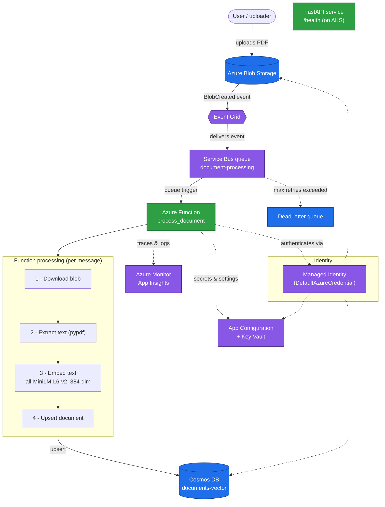
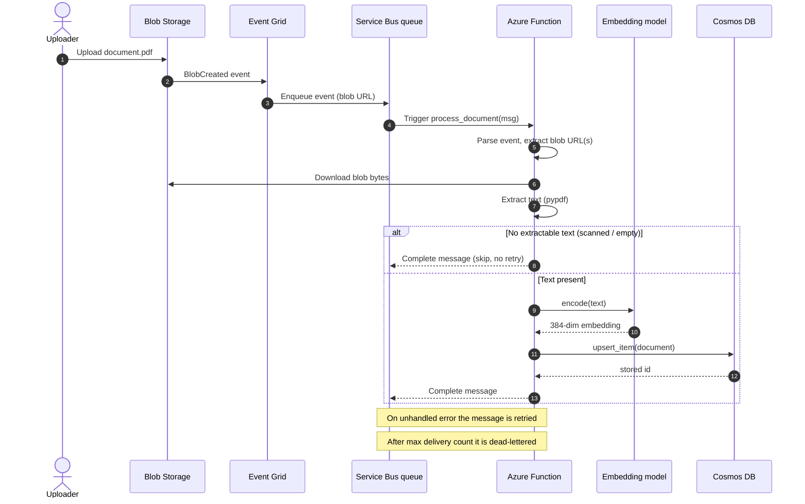

# DocuMind

DocuMind is an event-driven document-embedding pipeline on Azure. It ingests documents, extracts their text, turns that text into vector embeddings, and stores the embeddings in a vector-enabled NoSQL database. The long-term goal is to feed these embeddings into a Retrieval-Augmented Generation (RAG) system that answers questions over the stored documents. RAG retrieval itself is **not yet implemented** — the pipeline today ends at persistence in Cosmos DB.

The entire pipeline authenticates with **Azure Managed Identity**, so no connection strings or passwords are stored in the application for the production path.

---

## Table of contents

- [How it works](#how-it-works)
- [Architecture](#architecture)
- [Processing sequence](#processing-sequence)
- [Components](#components)
- [Data model](#data-model)
- [Repository layout](#repository-layout)
- [Running locally](#running-locally)
- [Deployment](#deployment)
- [Current status](#current-status)
- [Backlog](#backlog)
- [Security notes](#security-notes)

---

## How it works

1. A PDF is uploaded to **Azure Blob Storage**.
2. Blob creation raises an **Event Grid** `BlobCreated` event, which is delivered to an **Azure Service Bus** queue (`document-processing`).
3. The message triggers the **Azure Function** `process_document`, which:
   - downloads the blob,
   - extracts text with `pypdf`,
   - embeds the text with the `all-MiniLM-L6-v2` sentence-transformer (384 dimensions),
   - upserts the result into **Cosmos DB** (`documents-vector` container).
4. On failure, Service Bus retries the message; once the maximum delivery count is exhausted, the message is routed to the **dead-letter queue (DLQ)**.
5. A separate **FastAPI** service (on AKS) exposes a `/health` endpoint for liveness/readiness probes.

Processing is **idempotent**: the Cosmos document `id` is the SHA-256 of the blob URL, so re-processing the same blob overwrites the existing record rather than creating a duplicate.

---

## Architecture



> **RAG (planned):** a query service will embed the user's question with the same model and run a vector-distance search against the `documents-vector` container to retrieve the most relevant documents. Not yet built.

---

## Processing sequence



---

## Components

| Component | File / resource | Role |
|-----------|-----------------|------|
| **Ingestion Function** | [`documind-functions/function_app.py`](documind-functions/function_app.py) | Service Bus–triggered function that downloads, extracts, embeds, and stores documents. Lazy-initialises credential, Cosmos client, and model; telemetry is best-effort. |
| **Health service** | [`app.py`](app.py) | Minimal FastAPI app exposing `GET /health`, containerised and deployed to AKS. |
| **App Configuration / secrets** | [`appconfig.py`](appconfig.py), [`get_secret.py`](get_secret.py) | Load settings from Azure App Configuration (with Key Vault references) and a TTL-cached Key Vault secret helper. |
| **Telemetry** | [`telemetry.py`](telemetry.py) | Configures Azure Monitor OpenTelemetry for the function service. |
| **Vector-store experiments** | [`cosmos.py`](cosmos.py), [`azure_redis.py`](azure_redis.py), [`postgres.py`](postgres.py) | Standalone scripts exploring vector search on Cosmos DB, Redis (HNSW), and Postgres/pgvector. Reference/benchmark code, not part of the running pipeline. |
| **Messaging experiments** | [`azure_servicebus.py`](azure_servicebus.py) | Standalone script exercising Service Bus queues, topics, subscriptions, and the dead-letter queue. |
| **Kubernetes manifests** | [`deployment.yaml`](deployment.yaml), [`service.yaml`](service.yaml) | Deploy the FastAPI service (2 replicas) behind a `LoadBalancer`, with liveness/readiness probes on `/health`. |
| **Container image** | [`Dockerfile`](Dockerfile) | Two-stage build producing the FastAPI `uvicorn` image on `python:3.12-slim`. |

### Embedding model

All embeddings use **`all-MiniLM-L6-v2`** (Hugging Face `sentence-transformers`), producing **384-dimensional** vectors with **cosine** distance. The same model and dimensionality are used across every vector store so results are comparable.

---

## Data model

Documents are stored in the Cosmos DB `documents-vector` container:

```jsonc
{
  "id":       "<sha256 of blob URL>",   // deterministic → retries overwrite, not duplicate
  "userId":   "default-user",           // partition key
  "filename": "invoice-march.pdf",
  "blobUrl":  "https://.../invoice-march.pdf",
  "text":     "extracted document text (truncated to ~1.5 MB)",
  "embedding": [/* 384 float32 values */]
}
```

**Partition key: `/userId`.** Partitioning by user keeps each user's documents co-located, which suits the intended RAG query pattern (retrieve within a single user's corpus) and spreads load as the number of users grows. The current pipeline writes a fixed `default-user` until real user identity is wired in.

**Vector policy:** embeddings are indexed at path `/embedding` (`float32`, cosine, 384 dims). The raw `embedding` array is excluded from the standard property index to avoid indexing overhead; vector search uses the dedicated vector index.

**Size guard:** extracted text is truncated to ~1.5 MB (`MAX_TEXT_BYTES`) to stay under the Cosmos 2 MB item limit.

---

## Repository layout

```
documind/
├── app.py                      # FastAPI health service
├── appconfig.py                # App Configuration + Key Vault loader
├── get_secret.py               # TTL-cached Key Vault secret helper
├── telemetry.py                # Azure Monitor OpenTelemetry setup
├── cosmos.py                   # Cosmos DB vector-search experiment
├── azure_redis.py              # Redis HNSW vector-search experiment
├── postgres.py                 # Postgres/pgvector experiment
├── azure_servicebus.py         # Service Bus queue/topic/DLQ experiment
├── Dockerfile                  # Two-stage build for the FastAPI service
├── deployment.yaml             # AKS Deployment (2 replicas, probes)
├── service.yaml                # AKS LoadBalancer Service
├── indexing-policy.json        # Cosmos indexing policy reference
├── requirements.txt            # FastAPI service deps
└── documind-functions/
    ├── function_app.py         # The ingestion Function (core pipeline)
    ├── host.json               # Functions host config
    └── requirements.txt        # Function deps (torch CPU, azure SDKs, pypdf)
```

---

## Running locally

### FastAPI health service

```bash
pip install -r requirements.txt
uvicorn app:app --host 0.0.0.0 --port 8000
```

Then `GET http://localhost:8000/health` returns `{"status": "ok", "service": "documind", "version": "2"}`.

### Azure Function

The function uses `DefaultAzureCredential`, so local runs need an identity that can reach Cosmos DB, Blob Storage, and App Configuration (e.g. `az login`, or a `local.settings.json` with the appropriate connection settings). It is triggered by the `document-processing` Service Bus queue.

```bash
cd documind-functions
pip install -r requirements.txt
func start
```

---

## Deployment

**FastAPI service (AKS):**

```bash
docker build -t documindacrnna2005.azurecr.io/documind:v2 .
docker push documindacrnna2005.azurecr.io/documind:v2
kubectl apply -f deployment.yaml
kubectl apply -f service.yaml
```

The `Deployment` runs 2 replicas with liveness/readiness probes against `/health`; the `Service` exposes them on port 80 via a `LoadBalancer`.

**Azure Function:** deployed with the Azure Functions tooling (`func azure functionapp publish ...`). The `ServiceBusConnection` setting wires the queue trigger to the `document-processing` queue.

---

## Current status

- ✅ The pipeline works end to end: **Blob Storage → Event Grid → Service Bus → Function → Cosmos DB**.
- ✅ Processing is idempotent and handles empty/scanned PDFs gracefully.
- ⚠️ Azure Monitor analytics for the `documind-func` service is **not yet confirmed** — telemetry is wired up but end-to-end traces are unverified.
- ❌ RAG retrieval is **not implemented**.

---

## Backlog

### Phase 1 — Get it working

- Reproduce and capture any Cosmos DB write errors from a single test upload.
- Compare local (`local.settings.json`) and deployed Function App configuration.
- Build a test set: a clean PDF, a scanned image, and a corrupted file under `test-docs/`.
- Log every stage (received → extracted → written) with the document ID.
- Document the Cosmos DB schema in this README. ✅ (see [Data model](#data-model))
- Draw the architecture diagram. ✅ (see [Architecture](#architecture))

### Phase 2 — Make it robust

- Route failed Cosmos writes to a `failed-items` container instead of losing them.
- Confirm end-to-end idempotency with a double-upload test.
- Remove any remaining secrets from app settings in favour of managed identity / Key Vault.
- Define the storage account in Bicep for from-scratch provisioning.
- Add a unit test for the extract → DB-schema mapping.
- Set up GitHub Actions to deploy the Function App on push to `main`.

---

## Security notes

- The production pipeline authenticates with **Managed Identity** via `DefaultAzureCredential`; no secrets live in the function code path.
- The standalone experiment scripts (`postgres.py`, `azure_redis.py`, `azure_servicebus.py`) contain **hardcoded or environment-based credentials** and are reference/benchmark code only — they should not be run against production resources, and their embedded credentials should be rotated and removed before this repo is shared more widely.
- `.env` and local settings are git-ignored; keep real connection strings and passwords out of commits.
```